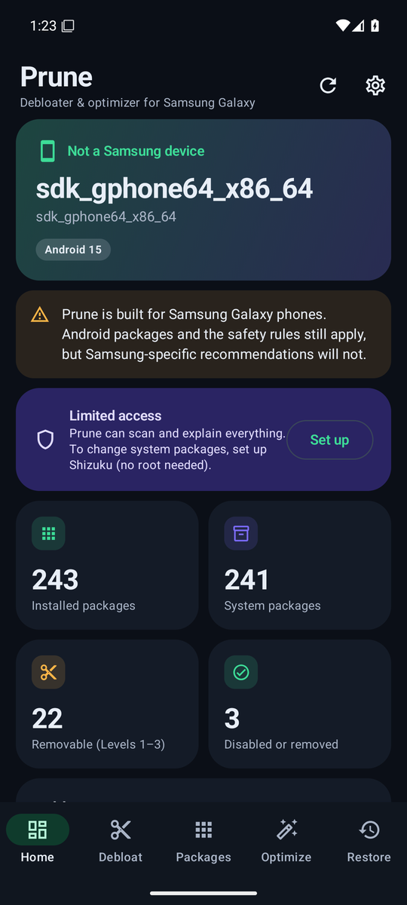
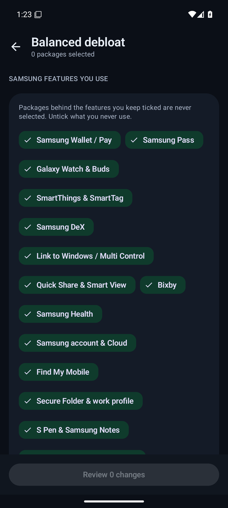
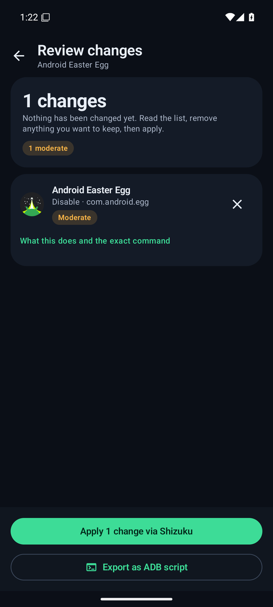
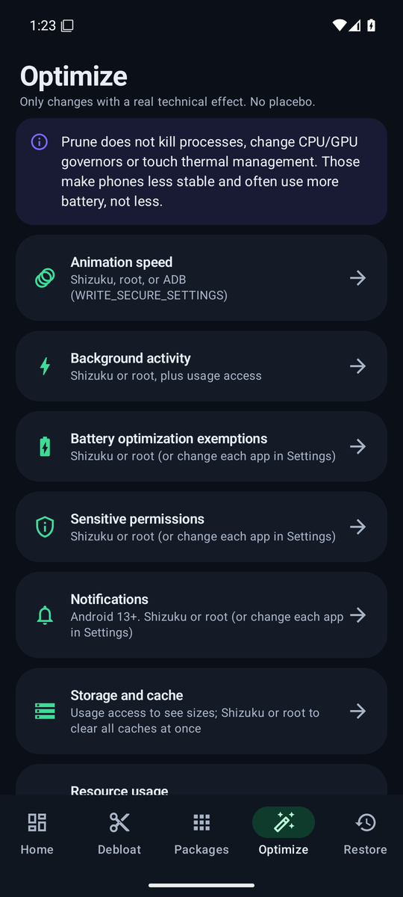

<p align="center">
  
</p>

<h1 align="center">Prune</h1>

<p align="center">
  <b>Debloater and optimizer for Samsung Galaxy phones.</b><br>
  Remove what you don't need, keep what you use, undo anything.
</p>

<p align="center">
  <a href="https://github.com/cyb3rl00m/prune-debloater/releases/latest"></a>
  
  
  
  
</p>

Prune is the Android counterpart of tools like Chris Titus Tech's WinUtil: it gives you control over the software on your Galaxy phone. It scans every package, explains what it is, rates the risk of removing it, and lets you debloat at four levels, from "just the obvious junk" to "every package, my choice". Every change is previewed, recorded with the state before it, verified after it, and can be undone.

Built for and first targeted at the **Galaxy S25 FE**, designed for Galaxy S, A and Z phones on One UI.

<p align="center">
  
  
  
  
</p>
<p align="center"><sub>Screenshots from the Android emulator used in CI.</sub></p>

## Download

Get **`Prune-1.0.0.apk`** from the [latest release](https://github.com/cyb3rl00m/prune-debloater/releases/latest), open it on the phone and allow installing from your browser or file manager. The SHA-256 checksum is in `SHA256SUMS.txt` next to it.

## What Prune does

**Debloat levels**

| Level | For | What it selects |
|---|---|---|
| 1 Minimal | A cleaner phone without real changes | Promoted apps, carrier apps, third-party preloads (Facebook, Netflix, ...), optional extras (Tips, Samsung Free, AR Zone, stickers). Samsung ecosystem and Google services untouched. |
| 2 Balanced | A noticeably lighter phone | Level 1, plus diagnostics and data-collection services, optional Samsung apps, optionally Google apps, and background restriction for apps unused for 30 days. |
| 3 Aggressive | As light as reasonably possible | Level 2, plus more Samsung components and Google apps by default. Read the warnings. |
| 4 Extreme / Custom | Experienced users | Every changeable package with its risk. Starts from the Level 3 selection; high-risk items need an extra confirmation. |

Every level is a starting point. Before anything is selected you tell Prune which Samsung features you use (Wallet, Pass, Galaxy Watch and Buds, SmartThings, DeX, Quick Share, Bixby, Health, Find My Mobile, Secure Folder, S Pen, Galaxy AI, Edge panels, accessibility, ...). Packages behind those features are never selected. Apps you opened in the last 14 days are never pre-selected either.

**Package manager.** Every package with its name, package id, description, category (Samsung, Google, carrier, preload, Android core, other system, yours), status, risk and recommended action. Search, filter, and act on single packages.

**Optimization center.** Only changes with a real technical effect, each with its explanation in the app:

- Animation scales (0.5x or off)
- Background restriction (`RUN_ANY_IN_BACKGROUND` app-op, the same switch as Android's "Restricted" battery mode) for apps you don't use
- Battery-optimization exemptions you don't need
- Sensitive permissions audit (location, microphone, camera, contacts, SMS, call log, ...)
- Notification permission audit (Android 13+)
- Storage per app and cache trimming with the free space actually measured
- Screen time and Android's own battery estimates per app
- App compilation now (the background dexopt job Android runs overnight)

Prune does not kill processes, change CPU/GPU governors, or touch thermal management.

**Restore center.** A full history with the state before and after each change, undo per change or per batch, "restore original state" for everything Prune ever touched, a list of every system package currently disabled or removed (by any tool), and an emergency ADB restore script you can keep on a computer.

## Permission levels

Android does not let a normal app disable or remove system packages. Prune is built around that, not against it:

| Tier | How you get it | What works |
|---|---|---|
| Standard | Install the app | Scanning, classification, explanations, usage and storage (with usage access), opening app settings, uninstalling apps you installed |
| ADB level | [Shizuku](https://shizuku.rikka.app/) via wireless debugging (no computer, no root) | Disable, uninstall for user, restore, background restriction, permissions, battery exemptions, animations, cache trimming, compilation, battery estimates |
| Root | Magisk / KernelSU / APatch (optional) | The same operations through `su`. Prune never needs root. |

No Shizuku and no root? Every plan can be exported as an ADB script and run from a computer. Prune records it and checks afterwards which changes are in effect.

## Set up Shizuku (one time, about 3 minutes)

1. Install Shizuku from Google Play or [GitHub](https://github.com/RikkaApps/Shizuku/releases).
2. **Settings → About phone → Software information →** tap **Build number** 7 times.
3. Connect to Wi-Fi. **Settings → Developer options →** turn on **Wireless debugging**.
4. Open Shizuku → **Start via Wireless debugging → Pairing**. In Wireless debugging tap **Pair device with pairing code** and type the code into Shizuku's notification.
5. Tap **Start** in Shizuku, then in Prune open **Home → Set up → Authorize Prune in Shizuku**.
6. Optional: **Grant both** on the same screen gives Prune usage access and the animation permission.

After a reboot open Shizuku and tap **Start** again.

## Safety model

- **Locked packages.** Telephony and emergency calling, IMS (VoLTE/VoWiFi), System UI, Settings, the shell, permission controller, package installer, content providers, network stack, Bluetooth, NFC and the secure element, biometrics, Knox Guard and Knox attestation, Google Play Services, WebView, One UI Home and emergency alerts can never be selected, not even in Custom mode.
- **Locked for this phone.** Your current launcher, phone app, SMS app and keyboard, apps with an accessibility service you turned on, device administrators, and every persistent system app.
- **Prune's rules win.** The community data (UAD-ng) marks for example Find My Mobile, Auto Blocker and Samsung Pay as "Recommended" to remove. Prune's own rules override that: they are Level 3, Custom-only, or tied to an ecosystem you can keep.
- **Reversible by default.** "Disable" and "Uninstall for this user" both keep the original APK in the system partition. `pm install-existing` brings any package back, and a factory reset restores everything.
- **Verified.** After every command Prune reads the real state back from Android. A change only counts as applied if Android confirms it.
- **Commands are argv lists**, never shell strings; package names, app-ops, permissions and settings are validated against strict patterns or whitelists.

If something misbehaves: **Restore → History → Undo**. If the phone cannot be used normally, connect it to a computer and run the emergency restore script, or:

```
adb shell pm install-existing --user 0 <package>
adb shell pm enable --user 0 <package>
```

## What has been tested

| Area | How | Status |
|---|---|---|
| Classification, levels, safety rules, command building, output parsers | 30+ JVM unit tests on every build | Verified |
| Real `pm disable-user`, `pm enable`, `pm uninstall -k --user`, `pm install-existing`, app-ops, `deviceidle`, `settings` | Run as the shell user (same uid as Shizuku) on an Android 15 emulator, result read back from Android | Verified on emulator |
| Full UI flow: every screen, disable a package and undo it through the UI | Compose UI tests with screenshots on the emulator | Verified on emulator |
| Minified, signed release APK installs and launches | Emulator smoke test | Verified on emulator |
| Shizuku user service binding, root through `su` | Needs a real phone with Shizuku / root | **Needs device testing** |
| Samsung package names, One UI blocking of `disable-user` on some packages, Samsung's real outputs | Needs a Galaxy phone | **Needs device testing** |
| Battery estimates format (`dumpsys batterystats`) on One UI | Needs a Galaxy phone | **Needs device testing** |

## Build from source

Requirements: JDK 17, Android SDK 35.

```
git clone https://github.com/cyb3rl00m/prune-debloater.git
cd prune-debloater
./gradlew testDebugUnitTest assembleDebug
```

The package database is built from `tools/prune_rules.json` and the UAD-ng list:

```
python3 tools/build_db.py
```

To change what Prune considers safe, edit `tools/prune_rules.json` (the script validates it, for example HIGH risk packages can only be Custom-only) and add a unit test.

## Credits

- Package descriptions and community removal tiers: [Universal Android Debloater Next Generation](https://github.com/Universal-Debloater-Alliance/universal-android-debloater-next-generation) (GPL-3.0). Prune bundles a Samsung, Google, AOSP, carrier and preload subset of its list.
- [Shizuku](https://github.com/RikkaApps/Shizuku) by RikkaApps for ADB-level access without root.
- Built by cyb3rl00m with help from Claude by Anthropic.

## Disclaimer

Prune changes system software. It is designed to be safe and reversible, but you use it at your own risk. Prune is not affiliated with Samsung or Google. Samsung, Galaxy and One UI are trademarks of Samsung Electronics.

## License

[GPL-3.0-or-later](LICENSE).
